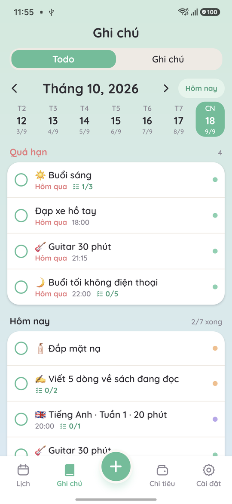
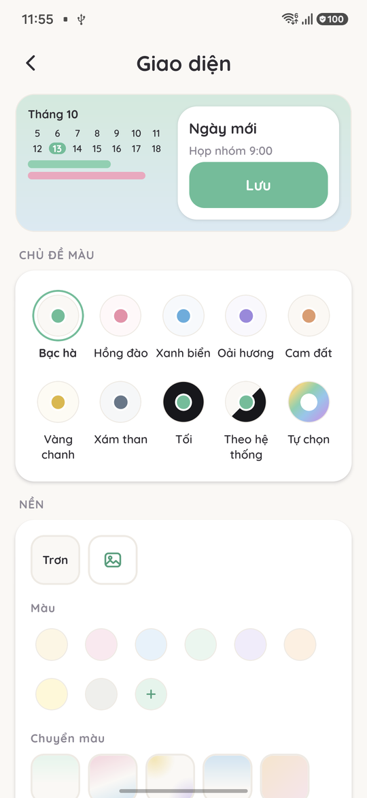
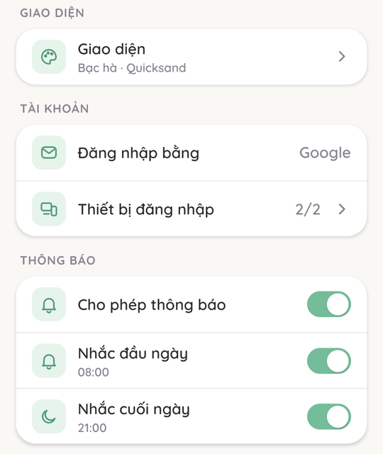

# Daynest

A personal app that keeps everything about your day in one place. Vietnamese and English, mobile first (Android now, iOS later).

## Features

- **Calendar:** solar and lunar calendar, events (lunar yearly repeat for death anniversaries), reminders, Google Calendar sync, menstrual cycle tracking.
- **Todo and notes:** todos with subtasks, repeat and per-day done state; notes with checklists, categories, pins, search, trash.
- **Daily digest:** a morning notification ("Today you have 4 tasks") and an evening one ("Today you completed 3/4 tasks") at times you choose; tapping opens the day's todo list.
- **Expenses:** spending by day, week, month, by category, monthly budget, recurring expenses.
- **Look and feel:** 8 colour themes, backgrounds, fonts and text size; works offline from cache; undo after delete.

## Screenshots

| Todo | Appearance | Settings |
| --- | --- | --- |
|  |  |  |

## Tech stack

| | |
| --- | --- |
| App | React Native + Expo (Expo Router), TypeScript |
| State and data | TanStack Query, Supabase JS client |
| Backend | Supabase: Postgres with row-level security, Auth (Google), Edge Functions |
| Notifications | `expo-notifications`, scheduled on the device |
| i18n | i18next (Vietnamese + English) |
| Tests | Jest; RLS tests in `supabase/tests` |

## Download

Get the latest APK from [GitHub Releases](https://github.com/danhbuidcn/daynest/releases/latest).

## Structure

| Folder | Content | Tech |
| --- | --- | --- |
| `app/` | Mobile app (Android + iOS) | React Native + Expo |
| `api/` | Backend API (not used in phase 1) | Go, on top of Supabase (Postgres, Auth, Storage) |
| `web/` | Web app (later) | Nuxt 3 + Nuxt UI |
| `docs/` | Docs: specs per sprint (Vietnamese) | — |
| `playbook/` | AI skills and reference docs for Claude Code | — |

## Sprint workflow

Every sprint goes through the same 5 phases. Each phase is one todo in `wip/` (see [CLAUDE.md](CLAUDE.md)) and waits for approval before work starts.

| # | Phase | Output |
| --- | --- | --- |
| 1 | **Scope** | What the sprint does and does not do |
| 2 | **Spec** | `docs/specs/sprint-N/index.md` (goals, scope, DoD) · main spec updated if scope changed |
| 3 | **Mockup** | `docs/specs/sprint-N/design/mockups.html` — new or changed screens only · approved before code |
| 4 | **Implement** | One step per item: code → `npm run typecheck && npm run lint && npm test` → try on a real device → commit + push |
| 5 | **Release** | [End of sprint](docs/specs/index.md#cuối-sprint-mọi-sprint): tick DoD → bump version → build APK → install on device → tag + GitHub Release |

## Docs

- [Docs index](docs/index.md)
- [Main spec](docs/specs/index.md)
