# Kiến trúc Daynest

Thuộc: [Spec tổng](index.md) · §3. File này vẽ lại kiến trúc bằng biểu đồ Mermaid; chi tiết từng phần nằm ở spec gốc (link ở mỗi mục).

Trạng thái: theo code tới S2 bước 6 (Event). Phần đánh dấu **(chưa code)** là theo spec, chưa có trong `app/`.

## Mục lục

1. [Tổng quan hệ thống](#1-tổng-quan-hệ-thống)
2. [Các lớp trong app](#2-các-lớp-trong-app)
3. [Lưu dữ liệu](#3-lưu-dữ-liệu)
4. [User hoạt động ra sao](#4-user-hoạt-động-ra-sao)
5. [Đăng nhập + phiên](#5-đăng-nhập--phiên)
6. [Giới hạn 2 thiết bị](#6-giới-hạn-2-thiết-bị)
7. [Đọc lịch: event lặp](#7-đọc-lịch-event-lặp)
8. [Ghi dữ liệu: không trùng, không mất](#8-ghi-dữ-liệu-không-trùng-không-mất)
9. [Xung đột dữ liệu](#9-xung-đột-dữ-liệu)
10. [Đồng bộ Google Calendar](#10-đồng-bộ-google-calendar)
11. [Nhắc nhở](#11-nhắc-nhở)
12. [Xử lý traffic](#12-xử-lý-traffic)
13. [Xử lý lỗi](#13-xử-lý-lỗi)

---

## 1. Tổng quan hệ thống

Không có server riêng. App gọi thẳng Supabase (dữ liệu) và Google (đăng nhập, lịch). Mọi quyền truy cập dữ liệu do Postgres RLS quyết định.

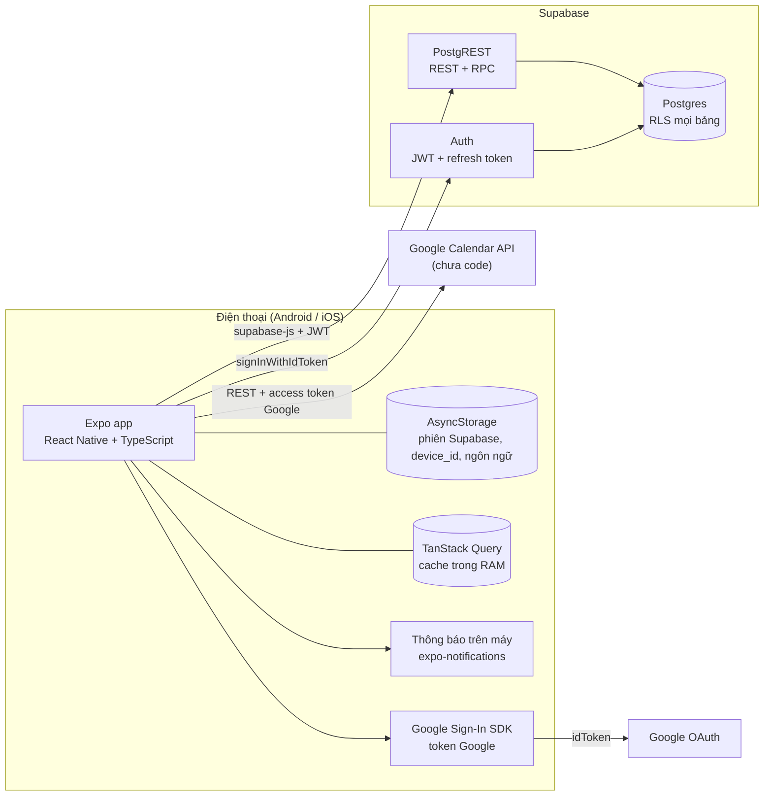

| Thành phần | Vai trò | Không làm |
| --- | --- | --- |
| Expo app | Toàn bộ UI + logic: trải event lặp, chọn mốc nhắc, đồng bộ Google | Không chạy nền khi app đóng (trừ thông báo đã đặt) |
| Supabase Auth | Đổi `idToken` Google → phiên Supabase (JWT có `session_id`) | Không lưu token Google |
| Postgres + RLS | Lưu dữ liệu, chặn truy cập chéo user, chặn máy đã bị đăng xuất | Không có logic nghiệp vụ ngoài vài hàm (`register_device`…) |
| Google Calendar | Lịch chính của user, đồng bộ 2 chiều khi bật | Không webhook, không đồng bộ nền |

### RLS là gì

**RLS (Row Level Security)** = luật phân quyền **theo từng dòng** của Postgres, gắn vào bảng. Mỗi lệnh `select / insert / update / delete` đều bị Postgres lọc qua luật này, dù gọi từ đâu.

Vì sao cần: app không có server riêng, key Supabase (`anon key`) nằm trong app nên ai cũng lấy được. Bảo mật không dựa vào app mà dựa vào RLS ở DB: có key cũng chỉ chạm được dòng của chính mình.

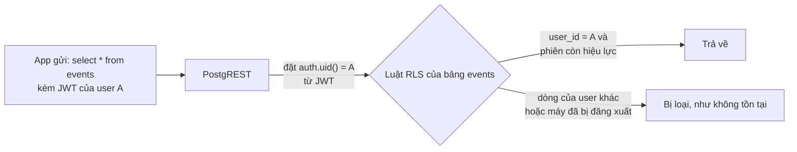

Luật thật của bảng `events` (migration S2):

```sql
create policy "events: all own" on public.events
for all to authenticated
using (user_id = (select auth.uid()) and (select public.session_active()))      -- được đọc / sửa / xoá dòng nào
with check (user_id = (select auth.uid()) and (select public.session_active())); -- được ghi dòng mới ra sao
```

- `auth.uid()`: id user lấy từ JWT, app không tự khai được.
- `session_active()`: phiên của máy còn trong `user_devices` → máy bị đá (mục 6) mất quyền ngay.
- `using`: lọc dòng khi đọc / sửa / xoá. `with check`: chặn ghi dòng mang `user_id` của người khác.
- Vi phạm khi ghi → lỗi `42501`. Đọc dòng không được phép → không lỗi, chỉ không thấy.

## 2. Các lớp trong app

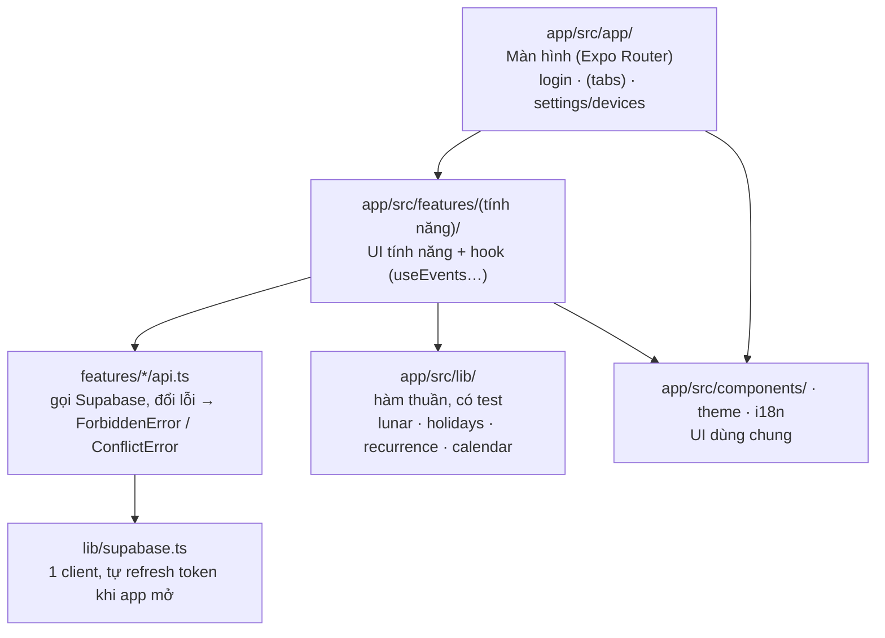

- `lib/` không gọi mạng, không import React → test bằng Jest (`app/src/__tests__/`).
- `api.ts` tách khỏi UI → hook (TanStack Query) lo cache, làm mới, gom lỗi.
- `AuthProvider` bọc toàn app: giữ `profile`, `settings`, kiểm tra phiên khi mở app / về foreground.

## 3. Lưu dữ liệu

Chi tiết cột: [S1 db.md](sprint-1/design/db.md) · [S2 db.md](sprint-2/design/db.md).

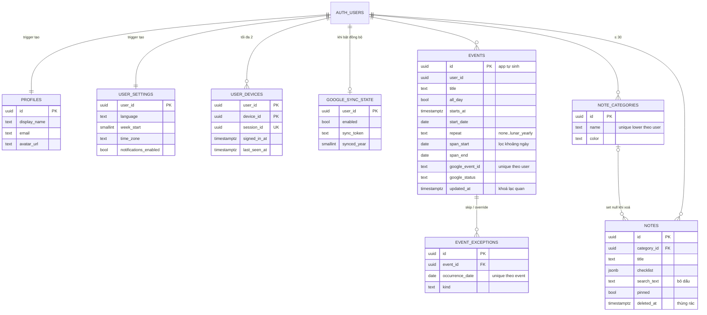

Nguyên tắc lưu:

| Nguyên tắc | Lý do |
| --- | --- |
| Mọi bảng có `user_id` + RLS `user_id = auth.uid()` và `session_active()` | Không lộ dữ liệu giữa user; máy bị đăng xuất dừng ngay |
| `id` do app sinh (uuid) | Gửi lại không tạo bản trùng |
| `updated_at` do trigger đặt | Dùng làm phiên bản cho khoá lạc quan |
| Event lặp = 1 dòng quy tắc + ngoại lệ | DB không phình; app tự trải ra các lần |
| `span_start` / `span_end` | Tải đúng event chạm khoảng ngày đang xem, có index |
| Ghi chú xoá mềm (`deleted_at`) | Thùng rác khôi phục được |
| Trên máy chỉ có phiên + cache | Online-only; cache chỉ để xem |

## 4. User hoạt động ra sao

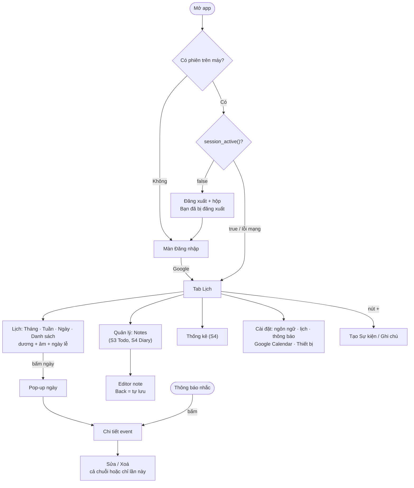

## 5. Đăng nhập + phiên

Spec: [S1 F2](sprint-1/F2-google-sign-in.md) · [S2 F7](sprint-2/F7-device-limit.md).

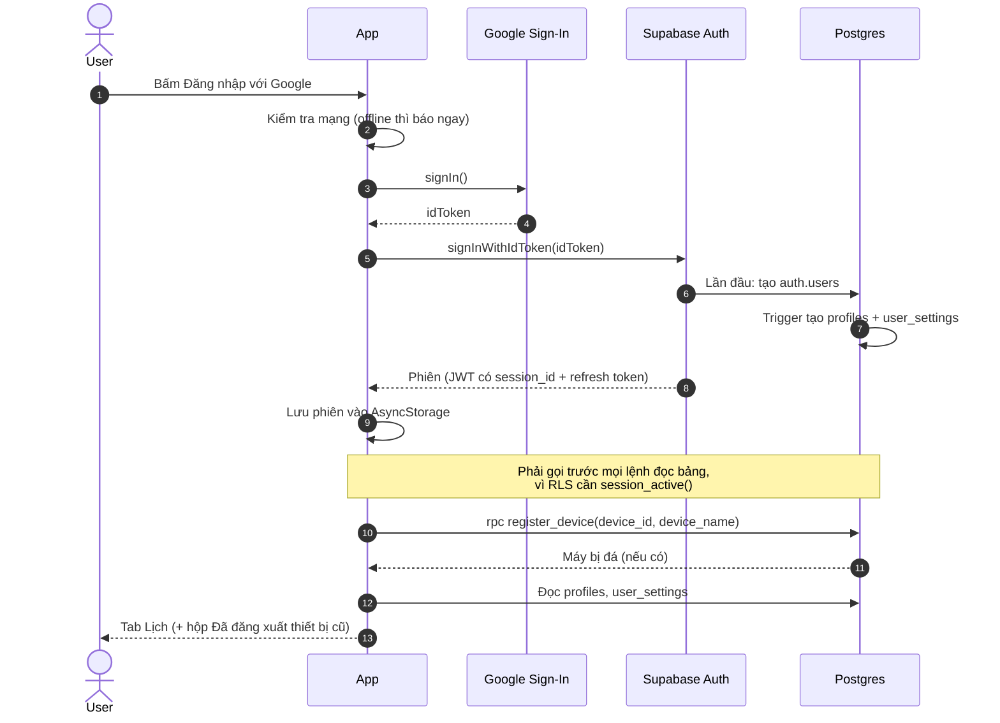

Vòng đời phiên trên 1 máy:

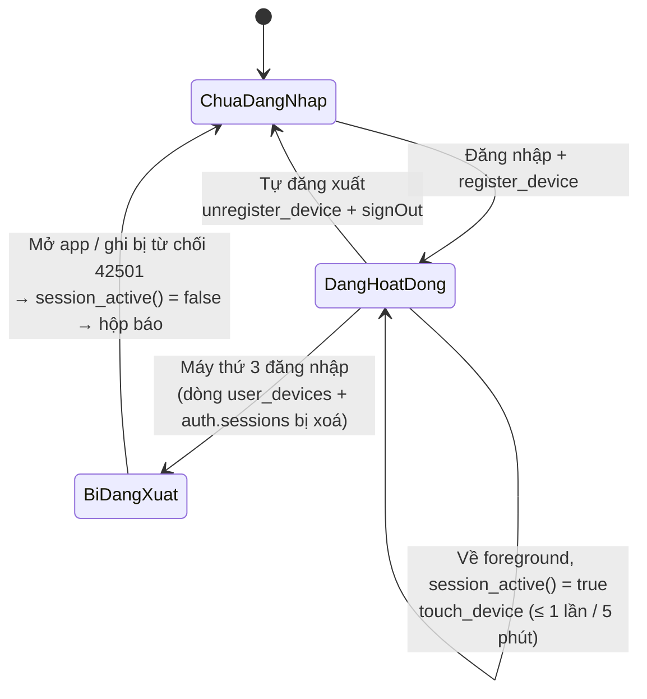

## 6. Giới hạn 2 thiết bị

Cùng 1 tài khoản, tối đa 2 máy. Máy thứ 3 đăng nhập → máy đăng nhập sớm nhất bị đăng xuất.

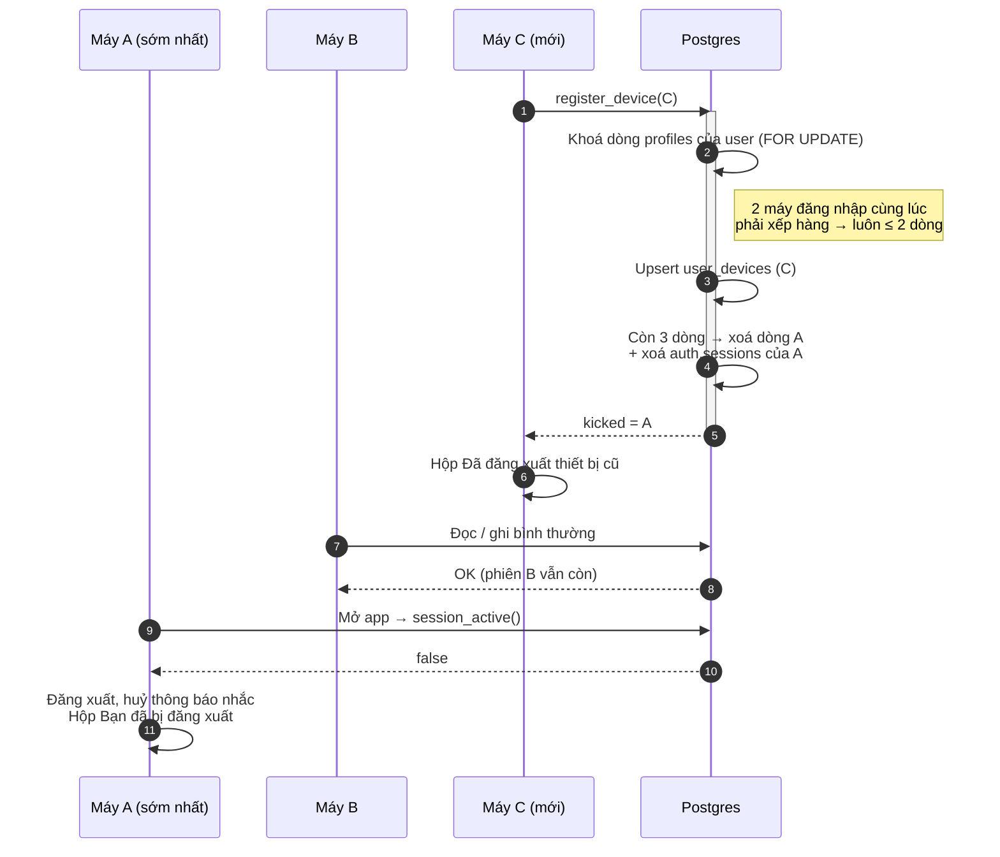

- Không có push từ server → máy A chỉ biết khi mở app hoặc khi gọi API bị từ chối (`42501`).
- `checkSessionActive()` chỉ đăng xuất khi DB trả **chắc chắn** `false`; lỗi mạng → coi như còn phiên (không đá nhầm).

## 7. Đọc lịch: event lặp

Spec: [S2 F1](sprint-2/F1-calendar.md) · [S2 F2](sprint-2/F2-event.md).

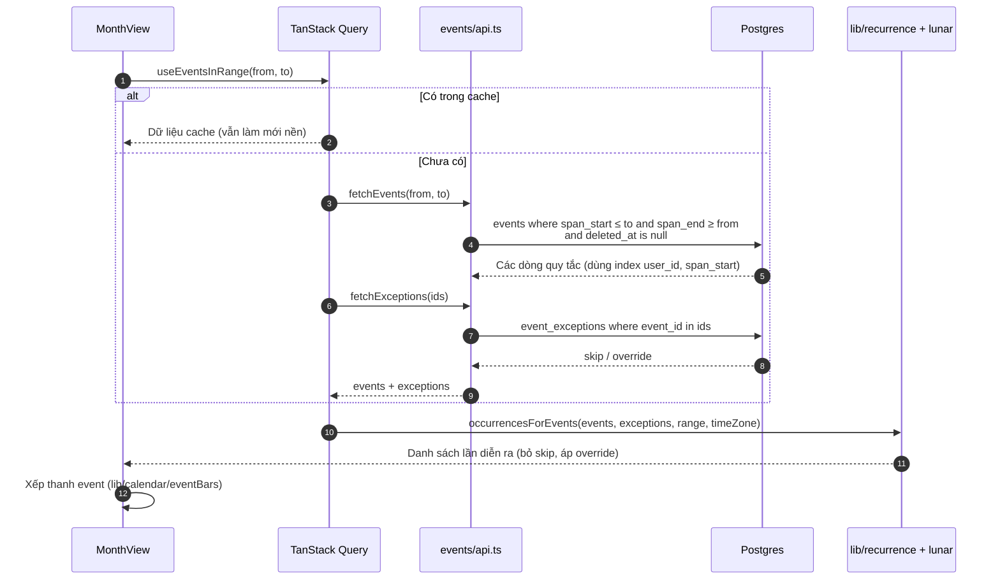

- DB chỉ lưu quy tắc; lặp dương (ngày/tuần/tháng/năm) và lặp năm âm lịch được trải ra **trên máy**, trong khoảng ngày đang xem.
- Lịch âm + ngày lễ tính hoàn toàn trên máy (`lib/lunar`, `lib/holidays`), không gọi mạng.

## 8. Ghi dữ liệu: không trùng, không mất

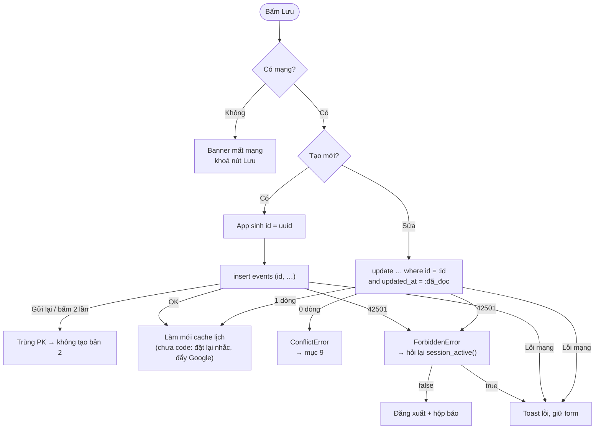

- `updated_at` giữ nguyên chuỗi API trả về (không đổi qua `Date`, tránh mất micro giây → so sánh sai).
- Sửa kiểu lặp / ngày bắt đầu → xoá ngoại lệ cũ (ngày gốc không còn khớp).
- Danh sách (notes, S3 todo): phân trang **keyset** `(pinned, updated_at, id)` → không lặp / sót khi dữ liệu đổi lúc đang cuộn.

## 9. Xung đột dữ liệu

### 9.1. Hai tài khoản khác nhau

Không bao giờ thấy hay sửa được dữ liệu của nhau — RLS chặn ở DB, không phụ thuộc app ([RLS là gì](#rls-là-gì)).

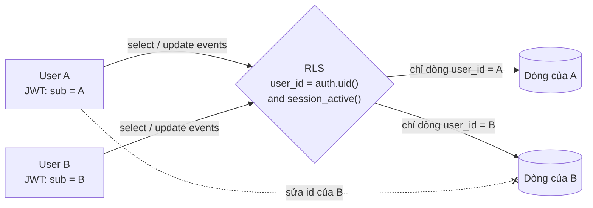

- A sửa/xoá dòng của B → 0 dòng bị ảnh hưởng (như không tồn tại).
- A không gắn được note vào danh mục của B, không gắn ngoại lệ vào event của B (`with check`).
- Test: `supabase/tests/rls_s1.sql`, `rls_s2.sql`.

### 9.2. Cùng tài khoản, 2 máy sửa cùng 1 event / note

Khoá lạc quan theo `updated_at`.

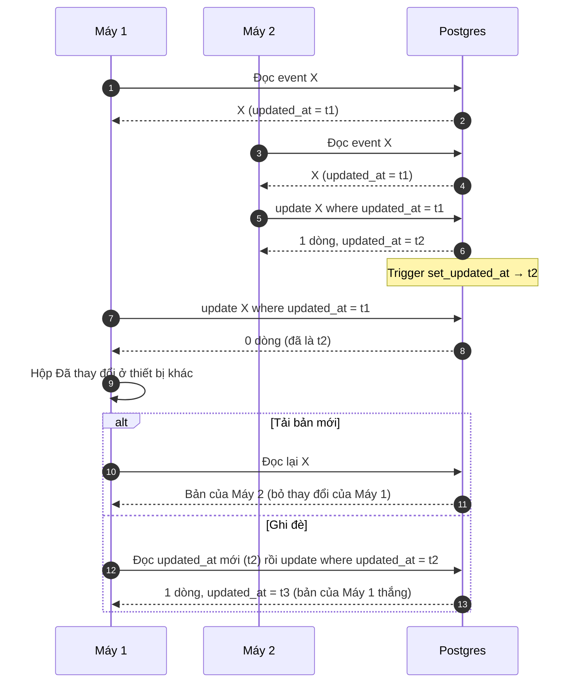

### 9.3. Các trường hợp xung đột khác

| Trường hợp | Cách xử lý |
| --- | --- |
| 1 máy xoá, máy kia đang sửa | Sửa → 0 dòng → hộp xung đột; Tải bản mới → không còn event, đóng form |
| 2 máy cùng sửa "chỉ lần này" 1 lần lặp | Upsert theo `(event_id, occurrence_date)` → 1 ngoại lệ, bản ghi sau cùng thắng |
| 2 máy cùng đăng nhập lúc 2 máy khác đang dùng | `register_device` khoá theo user → xếp hàng, luôn ≤ 2 máy |
| 2 máy cùng bật đồng bộ Google | Xem [mục 10](#10-đồng-bộ-google-calendar): id cố định + upsert theo `google_event_id` |
| Sửa ở Daynest và trên Google giữa 2 lần đồng bộ | Bản sửa sau cùng thắng (so `updated` Google với `updated_at`) |
| Bấm Lưu 2 lần / mạng chập chờn | `id` app sinh → không tạo trùng |

## 10. Đồng bộ Google Calendar

**(chưa code)** — spec: [S2 F4](sprint-2/F4-google-calendar.md). Chỉ khi bật trong Cài đặt; phạm vi = event năm hiện tại + event lặp còn diễn ra trong năm (không đẩy lặp âm).

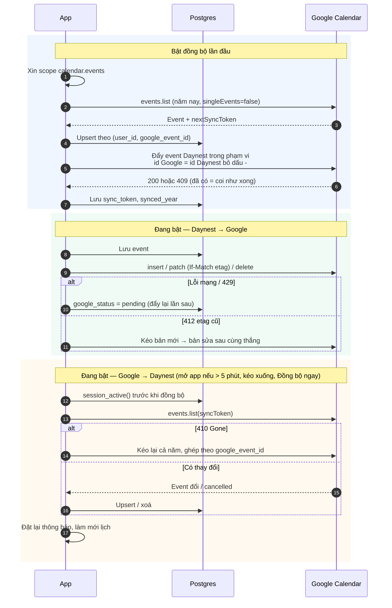

- Token Google chỉ ở trên máy (SDK tự làm mới), không lưu DB.
- Tắt đồng bộ → giữ nguyên dữ liệu 2 bên, giữ `google_event_id` để bật lại ghép đúng, không trùng.

## 11. Nhắc nhở

**(chưa code)** — spec: [S2 F3](sprint-2/F3-reminders.md). Thông báo đặt trên từng máy từ dữ liệu DB; không push từ server.

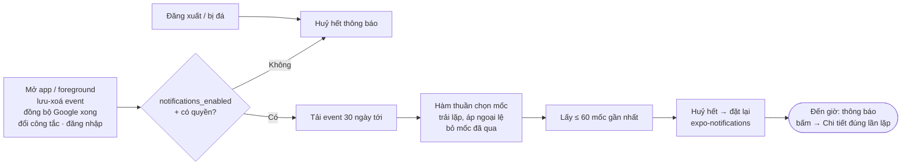

## 12. Xử lý traffic

Mục tiêu: 100 user cùng lúc, tổng ~10.000 user ([Spec tổng §3](index.md#mục-tiêu-tải) · gói Supabase: [supabase-plans.md](supabase-plans.md)).

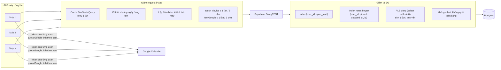

| Cơ chế | Tác dụng |
| --- | --- |
| Không server riêng, không trạng thái chung giữa user | Không có điểm nghẽn ngoài Supabase; mỗi user chỉ chạm dòng của mình |
| Event lặp lưu 1 dòng | DB ~10–50 KB/user → 100–500 MB cho 10.000 user (sát 500 MB, theo dõi) |
| Truy vấn theo khoảng ngày + index | Đọc lịch tháng chỉ vài chục dòng/user |
| Google `429` / `rateLimitExceeded` | Chờ tăng dần rồi thử lại (lúc đẩy hàng loạt) |
| Kiểm tra tải mỗi sprint | DB local, seed 10.000 user, 100 user ảo × 5 phút → 0 lỗi, p95 < 1 s ([S2 db.md](sprint-2/design/db.md#kiểm-tra-tải)) |

## 13. Xử lý lỗi

[Spec tổng §5](index.md#5-xử-lý-lỗi-chung).

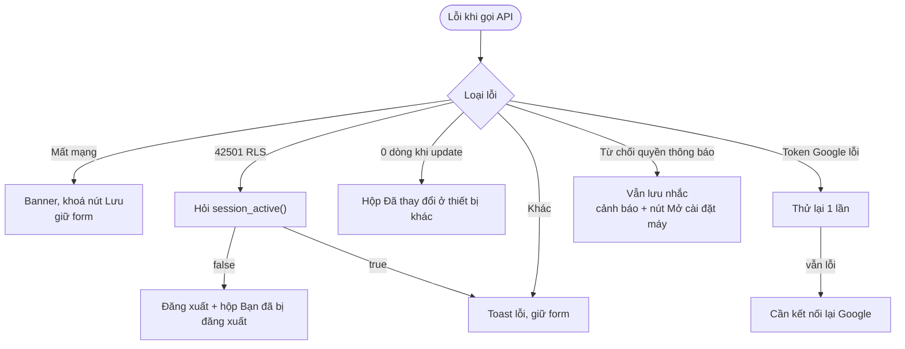
