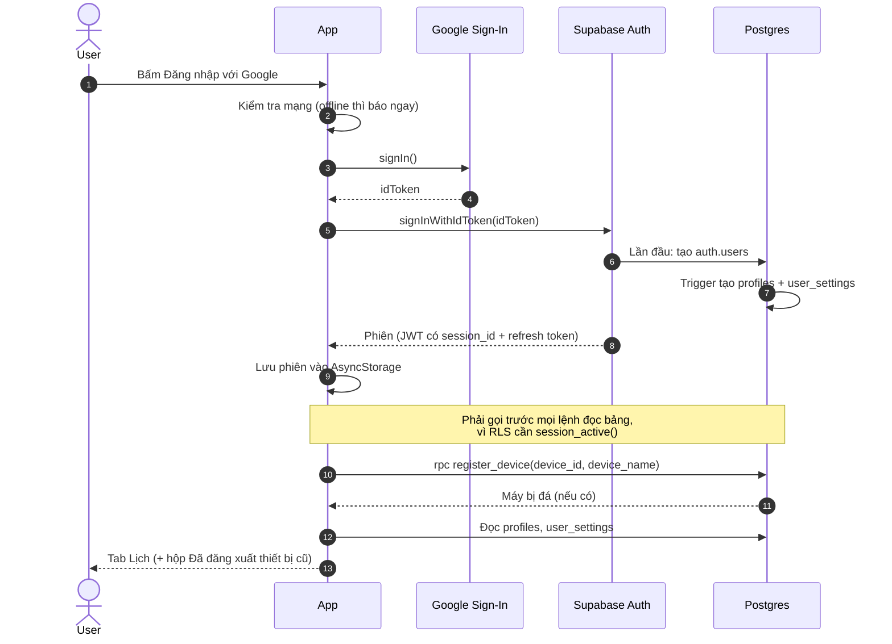
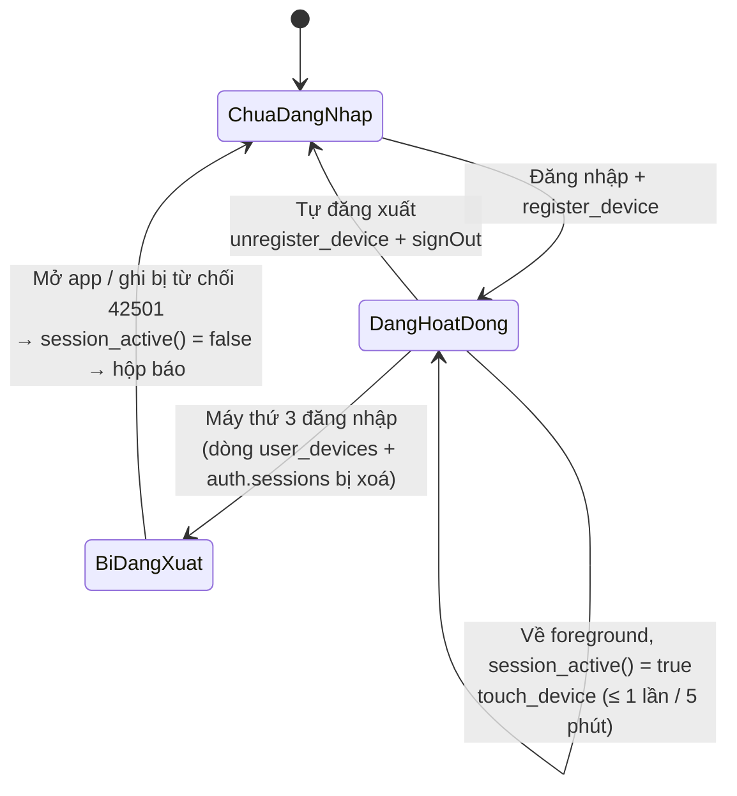
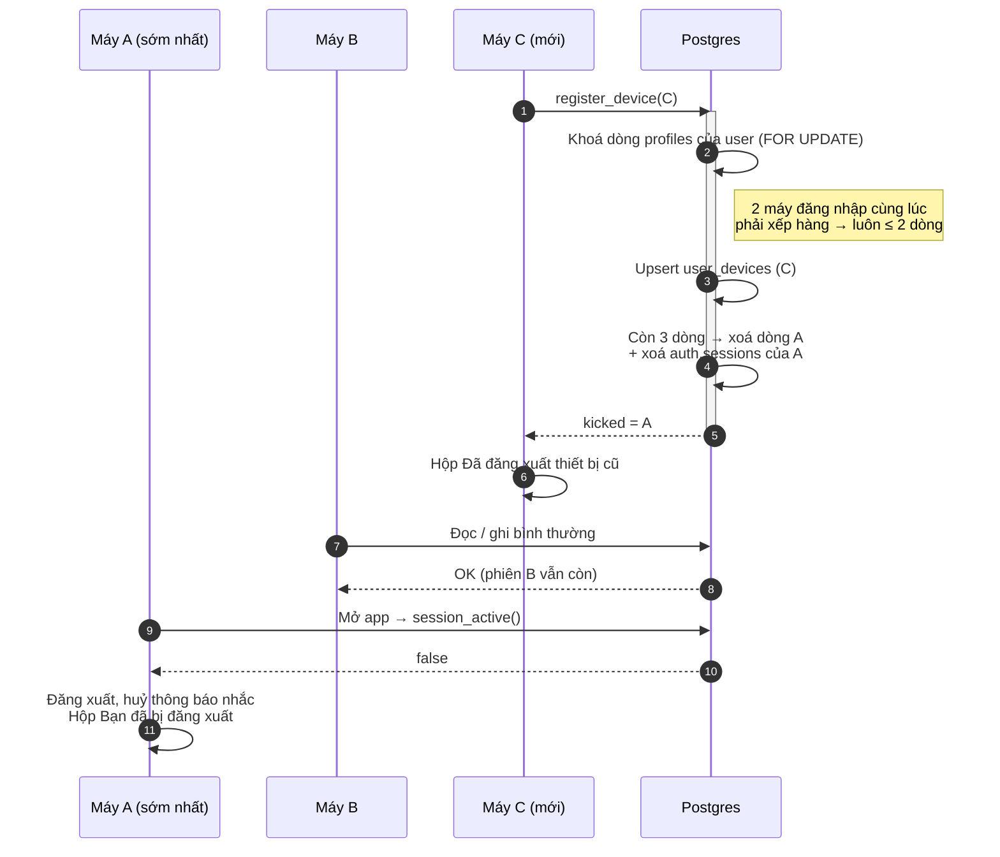

# Đăng nhập + phiên

Thuộc: [Kiến trúc](index.md).

Spec: [S1 F2](../sprint-1/F2-google-sign-in.md) · [S2 F7](../sprint-2/F7-device-limit.md).

Vòng đời phiên trên 1 máy:

## Giới hạn 2 thiết bị

Cùng 1 tài khoản, tối đa 2 máy. Máy thứ 3 đăng nhập → máy đăng nhập sớm nhất bị đăng xuất.

- Không có push từ server → máy A chỉ biết khi mở app hoặc khi gọi API bị từ chối (`42501`).
- `checkSessionActive()` chỉ đăng xuất khi DB trả **chắc chắn** `false`; lỗi mạng → coi như còn phiên (không đá nhầm).
