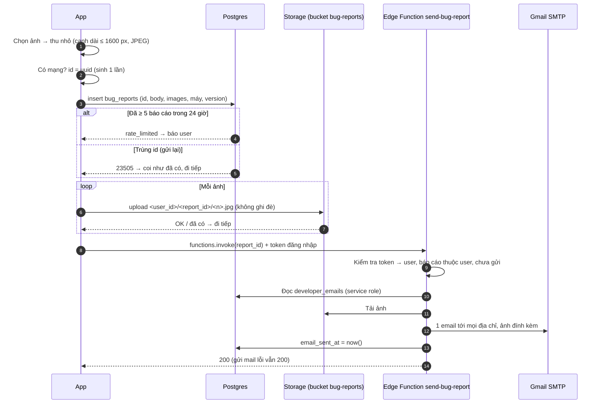

# Báo lỗi

Thuộc: [Kiến trúc](index.md).

Spec: [S5](../sprint-5/index.md) · chi tiết bảng, Storage, Edge Function: [S5 db.md § Báo lỗi](../sprint-5/design/db.md#báo-lỗi). Code: `features/bugReport/api.ts`, `supabase/functions/send-bug-report/`.

Cài đặt → Báo lỗi: user viết nội dung + ≤ 3 ảnh → nhà phát triển nhận email kèm ảnh.

| Quy tắc | Lý do |
| --- | --- |
| Thứ tự: báo cáo → ảnh → email; `id` app sinh | Gửi lại sau lần gửi dở chỉ làm phần còn thiếu, không tạo báo cáo thứ 2 |
| User chỉ insert, không đọc lại; ảnh không đọc, không xoá | Báo cáo chỉ nhà phát triển xem trên Supabase |
| ≤ 5 / 24 giờ: trigger `check_bug_report_limit`, khoá theo user | 2 lần gửi cùng lúc không vượt 5; chặn spam email |
| Email do Edge Function gửi | Cần service role (đọc `developer_emails`, tải ảnh) và mật khẩu Gmail — không được nằm trong app |
| Gửi mail lỗi → `email_sent_at` để null, vẫn trả 200 | Báo cáo đã lưu; user không phải gửi lại |

- Deploy function + đặt secret Gmail: `supabase/db functions` ([supabase/README.md](../../../supabase/README.md)).
