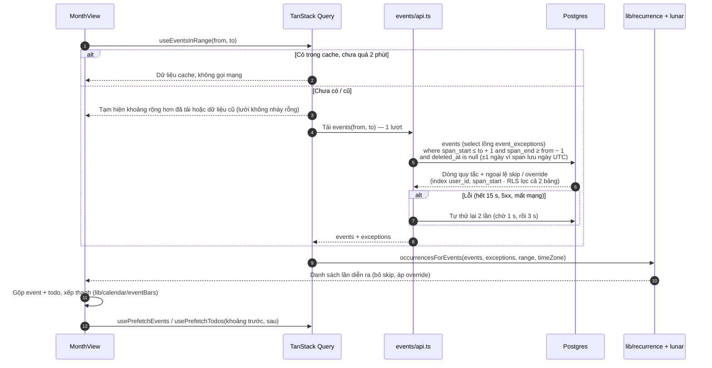

# Đọc lịch: event lặp

Thuộc: [Kiến trúc](index.md).

Spec: [S2 F1](../sprint-2/F1-calendar.md) · [S2 F2](../sprint-2/F2-event.md) · [S5](../sprint-5/index.md) (todo, chu kỳ) · [S6](../sprint-6/index.md) (tải 1 lượt, lỗi khi tải, ô tháng 5 thanh).

Tab Lịch đọc 3 nguồn: event, todo, ngày có kinh. Event và todo cùng 1 cách (dưới đây); kỳ kinh tải riêng.

- DB chỉ lưu quy tắc; lặp dương (ngày/tuần/tháng/năm) và lặp năm âm lịch được trải ra **trên máy**, trong khoảng ngày đang xem.
- Lịch âm + ngày lễ tính hoàn toàn trên máy (`lib/lunar`, `lib/holidays`), không gọi mạng.
- **Todo** (`features/todos/useTodos.ts`): giống event — `todos` lồng `todo_exceptions`, 1 lượt, trải bằng cùng `lib/recurrence`; ngoại lệ `status` giữ trạng thái xong của từng lần lặp. Tick trên lịch → `useSetTodoStatus`.
- **Kỳ kinh** (`features/cycle/`): chỉ khi bật trong Cài đặt. Tải `period_days` 12 tháng gần nhất (1 query, không theo khoảng đang xem) → `lib/cycle` nhóm thành kỳ, dự đoán kỳ sau theo độ dài chu kỳ → đánh dấu ô ngày.
- Cache: TanStack Query 2 phút trong RAM, lưu AsyncStorage 7 ngày ([queryClient.ts](../../../app/src/features/cache/queryClient.ts)). Lưu xong đặt dòng đã lưu thẳng vào cache ([data-writes.md](data-writes.md)). Có mạng lại → tải lại phần đang xem · mở lại app → tải lại nếu cũ hơn 2 phút.
- Tải lỗi ([errors.md](errors.md)): đã có dữ liệu → giữ + dòng "Chưa cập nhật được · Thử lại" · chưa có → thẻ lỗi + "Thử lại" · tải lần đầu hiện khung xương (lưới, số ngày, ngày âm hiện ngay; chỉ thanh event là khối xám).
