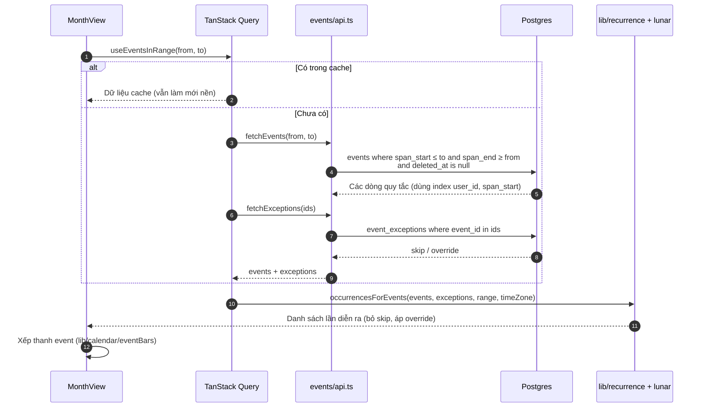

# Đọc lịch: event lặp

Thuộc: [Kiến trúc](index.md).

Spec: [S2 F1](../sprint-2/F1-calendar.md) · [S2 F2](../sprint-2/F2-event.md).

- DB chỉ lưu quy tắc; lặp dương (ngày/tuần/tháng/năm) và lặp năm âm lịch được trải ra **trên máy**, trong khoảng ngày đang xem.
- Lịch âm + ngày lễ tính hoàn toàn trên máy (`lib/lunar`, `lib/holidays`), không gọi mạng.
