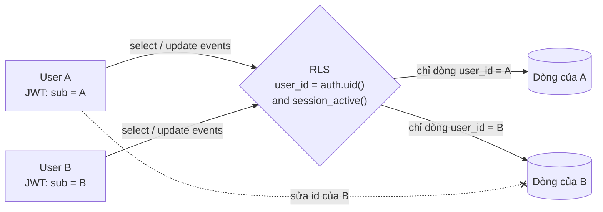
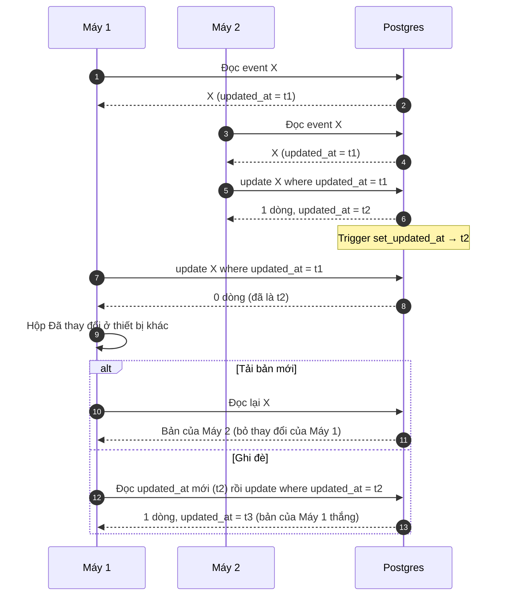

# Xung đột dữ liệu

Thuộc: [Kiến trúc](index.md).

## Hai tài khoản khác nhau

Không bao giờ thấy hay sửa được dữ liệu của nhau — RLS chặn ở DB, không phụ thuộc app ([RLS là gì](database.md#rls-là-gì)).

- A sửa/xoá dòng của B → 0 dòng bị ảnh hưởng (như không tồn tại).
- A không gắn được note vào danh mục của B, không gắn ngoại lệ vào event của B (`with check`).
- Test: `supabase/tests/rls_s1.sql`, `rls_s2.sql`, `rls_s4.sql`, `rls_s4_colour.sql`, `rls_s5.sql` (chạy `supabase/db test`).

## Cùng tài khoản, 2 máy sửa cùng 1 event / note

Khoá lạc quan theo `updated_at`.

## Các trường hợp xung đột khác

| Trường hợp | Cách xử lý |
| --- | --- |
| 1 máy xoá, máy kia đang sửa | Sửa → 0 dòng → hộp xung đột; Tải bản mới → không còn event, đóng form |
| 2 máy cùng sửa "chỉ lần này" 1 lần lặp | Upsert theo `(event_id, occurrence_date)` → 1 ngoại lệ, bản ghi sau cùng thắng |
| 2 máy cùng đăng nhập lúc 2 máy khác đang dùng | `register_device` khoá theo user → xếp hàng, luôn ≤ 2 máy |
| 2 máy cùng bật đồng bộ Google | Xem [Đồng bộ Google](google-sync.md): id cố định + upsert theo `google_event_id` |
| Sửa ở Daynest và trên Google giữa 2 lần đồng bộ | Bản sửa sau cùng thắng (so `updated` Google với `updated_at`) |
| Bấm Lưu 2 lần / mạng chập chờn | `id` app sinh → không tạo trùng |
