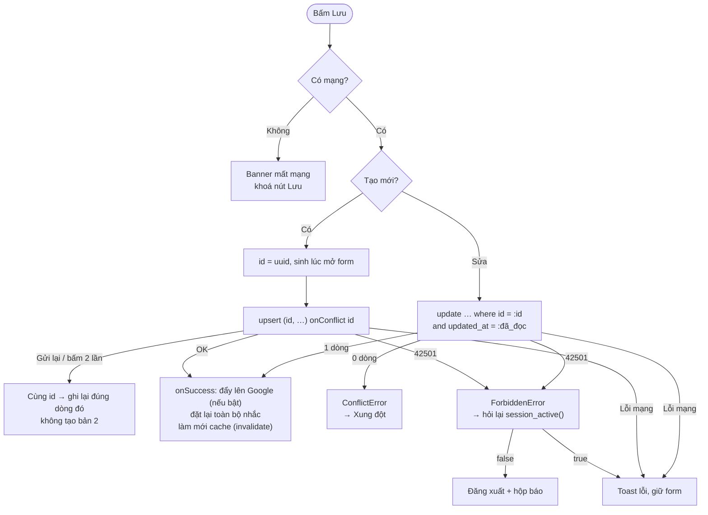

# Ghi dữ liệu: không trùng, không mất

Thuộc: [Kiến trúc](index.md).

- `updated_at` giữ nguyên chuỗi API trả về (không đổi qua `Date`, tránh mất micro giây → so sánh sai).
- Sửa kiểu lặp / ngày bắt đầu → xoá ngoại lệ cũ (ngày gốc không còn khớp).
- Danh sách (notes, thùng rác): phân trang **keyset** `(pinned, updated_at, id)` → không lặp / sót khi dữ liệu đổi lúc đang cuộn.
