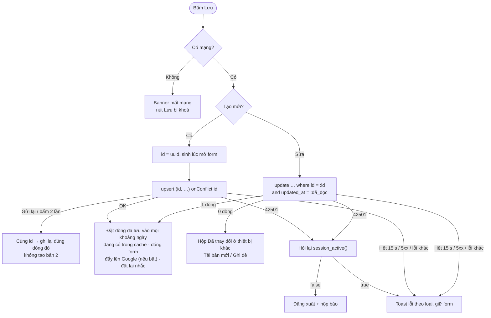
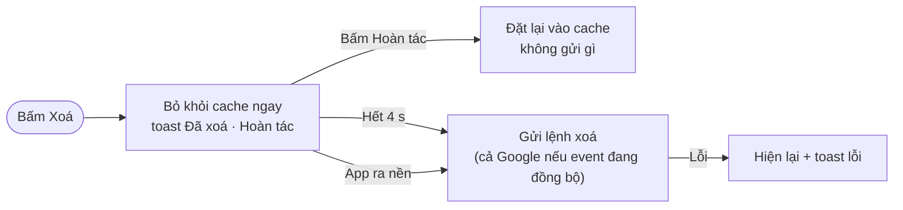

# Ghi dữ liệu: không trùng, không mất

Thuộc: [Kiến trúc](index.md).

Spec: [S3](../sprint-3/index.md) (idempotency) · [S6 §1, §5](../sprint-6/index.md#1-lưu-nhanh) (lưu nhanh, Hoàn tác).

## Lưu form

Form chờ server ghi xong rồi mới đóng (~1 lượt gọi). Server trả về dòng đã lưu → đặt thẳng vào cache, **không tải lại**.

- Ghi **không tự thử lại** (người dùng bấm lại; `id` app sinh nên không trùng). Đọc mới tự thử lại ([errors.md](errors.md)).
- "Đặt dòng đã lưu vào cache" là hàm thuần, có test: thêm mới, sửa, đổi ngày sang khoảng khác, xoá. Event / todo lặp: đặt dòng quy tắc vào mọi khoảng nó chạm → app tự trải lần lặp. "Chỉ lần này": đặt ngoại lệ cùng cách.
- Lần tải kế tiếp kiểm lại với server ở nền.
- `updated_at` giữ nguyên chuỗi API trả về (không đổi qua `Date`, tránh mất micro giây → so sánh sai).
- Sửa kiểu lặp / ngày bắt đầu → xoá ngoại lệ cũ (ngày gốc không còn khớp).
- Tick todo: hiện ngay trên máy, gửi server; lỗi → trả về như cũ + toast.

## Xoá: Hoàn tác 4 s

Event, todo (cả "Chỉ lần này" và "Tất cả"), khoản chi. Không còn hộp xác nhận xoá; event / todo lặp vẫn có hộp "Chỉ lần này / Tất cả".

- Mất mạng → nút Xoá bị khoá, nên không có lệnh xoá chờ mạng.
- Note: xoá vào thùng rác (`deleted_at`), khôi phục được — không dùng Hoàn tác 4 s. Xoá nhóm chi tiêu, quy tắc khoản chi lặp: vẫn có hộp xác nhận.

## Mất mạng

Online-only: mất mạng chỉ xem dữ liệu đã có trên máy. **Mọi thao tác ghi bị khoá** ở mọi màn (Lưu, Xoá, tick todo, tick ngày có kinh, Gửi báo lỗi) bằng 1 hook chung. Ngoại lệ: đổi giao diện vẫn được trên máy, có mạng lại thì lưu lên tài khoản.

## Danh sách

Notes, thùng rác: phân trang **keyset** `(pinned, updated_at, id)` → không lặp / sót khi dữ liệu đổi lúc đang cuộn.
