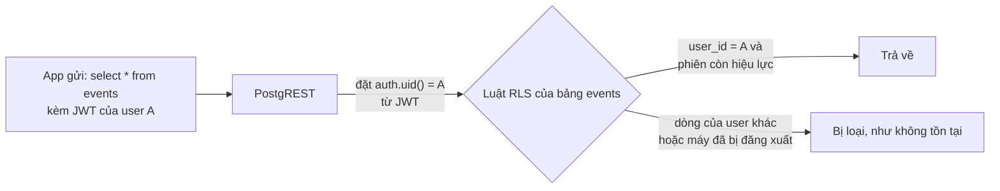

# Dữ liệu (DB)

Thuộc: [Kiến trúc](index.md).

Chi tiết cột: [S1 db.md](../sprint-1/design/db.md) · [S2 db.md](../sprint-2/design/db.md) · [S4 db.md](../sprint-4/design/db.md) · [S5 db.md](../sprint-5/design/db.md). Sơ đồ chỉ ghi cột chính.

```mermaid
erDiagram
  AUTH_USERS ||--|| PROFILES : "trigger tạo"
  AUTH_USERS ||--|| USER_SETTINGS : "trigger tạo"
  AUTH_USERS ||--o{ USER_DEVICES : "tối đa 2"
  AUTH_USERS ||--o| GOOGLE_SYNC_STATE : "khi bật đồng bộ"
  AUTH_USERS ||--o{ EVENTS : ""
  EVENTS ||--o{ EVENT_EXCEPTIONS : "skip / override"
  AUTH_USERS ||--o{ NOTE_CATEGORIES : "≤ 30"
  NOTE_CATEGORIES |o--o{ NOTES : "set null khi xoá"
  AUTH_USERS ||--o{ NOTES : ""
  AUTH_USERS ||--o{ TODOS : ""
  TODOS ||--o{ TODO_EXCEPTIONS : "skip / override / status"
  AUTH_USERS ||--o{ PERIOD_DAYS : "ngày có kinh"
  AUTH_USERS ||--o{ EXPENSE_CATEGORIES : "3 nhóm có sẵn + tự tạo"
  EXPENSE_CATEGORIES ||--o{ EXPENSES : "cascade khi xoá nhóm"
  AUTH_USERS ||--o{ BUG_REPORTS : "≤ 5 / 24 giờ"

  PROFILES {
    uuid id PK
    text display_name
    text email
    text avatar_url
  }
  USER_SETTINGS {
    uuid user_id PK
    text language
    smallint week_start
    text time_zone
    bool notifications_enabled
    bool cycle_enabled
    smallint cycle_length
    smallint period_length
    time period_reminder_time
  }
  USER_DEVICES {
    uuid user_id PK
    uuid device_id PK
    uuid session_id UK
    timestamptz signed_in_at
    timestamptz last_seen_at
  }
  EVENTS {
    uuid id PK "app tự sinh"
    uuid user_id
    text title
    bool all_day
    timestamptz starts_at
    date start_date
    text repeat "none..lunar_yearly"
    date span_start "lọc khoảng ngày"
    date span_end
    text google_event_id "unique theo user"
    text google_status
    timestamptz updated_at "khoá lạc quan"
  }
  EVENT_EXCEPTIONS {
    uuid id PK
    uuid event_id FK
    date occurrence_date "unique theo event"
    text kind
  }
  GOOGLE_SYNC_STATE {
    uuid user_id PK
    bool enabled
    text sync_token
    smallint synced_year
  }
  NOTE_CATEGORIES {
    uuid id PK
    text name "unique lower theo user"
    text color
  }
  NOTES {
    uuid id PK
    uuid category_id FK
    text title
    jsonb checklist
    text search_text "bỏ dấu"
    bool pinned
    timestamptz deleted_at "thùng rác"
  }
  TODOS {
    uuid id PK "app tự sinh"
    text title
    text repeat "giống events"
    date span_start
    date span_end
    jsonb subtasks
    bool done "todo không lặp"
    timestamptz deleted_at
  }
  TODO_EXCEPTIONS {
    uuid id PK
    uuid todo_id FK
    date occurrence_date "unique theo todo"
    text kind "skip, override, status"
    bool done "xong theo từng lần lặp"
  }
  PERIOD_DAYS {
    uuid id PK
    date day "unique theo user"
  }
  EXPENSE_CATEGORIES {
    uuid id PK
    text key "food, transport, bills = nhóm có sẵn"
    text name "nhóm tự tạo"
    text icon
    text color
  }
  EXPENSES {
    uuid id PK
    uuid category_id FK
    bigint amount
    date spent_on
    text note
  }
  BUG_REPORTS {
    uuid id PK "app tự sinh"
    text body
    text_array images "đường dẫn Storage, ≤ 3"
    timestamptz email_sent_at "null = chưa gửi"
  }
  APP_CONFIG {
    bool id PK "1 dòng"
    int min_version_code "bản cũ hơn → Cần cập nhật"
  }
  DEVELOPER_EMAILS {
    text email PK "chỉ Edge Function đọc"
  }
```

Nguyên tắc lưu:

| Nguyên tắc | Lý do |
| --- | --- |
| Mọi bảng dữ liệu user có `user_id` + RLS `user_id = auth.uid()` và `session_active()` | Không lộ dữ liệu giữa user; máy bị đăng xuất dừng ngay |
| `id` do app sinh (uuid) | Gửi lại không tạo bản trùng |
| `updated_at` do trigger đặt | Dùng làm phiên bản cho khoá lạc quan |
| Event lặp = 1 dòng quy tắc + ngoại lệ | DB không phình; app tự trải ra các lần |
| `span_start` / `span_end` | Tải đúng event chạm khoảng ngày đang xem, có index |
| Ghi chú xoá mềm (`deleted_at`) | Thùng rác khôi phục được |
| Todo lặp: trạng thái xong lưu theo từng lần (`todo_exceptions.kind = status`) | Tick 1 lần không ảnh hưởng các lần khác; quy tắc lặp vẫn 1 dòng |
| Khoản chi xoá hẳn, không `deleted_at`; tổng tháng tính ở DB (`expense_monthly_totals`) | Đơn giản; biểu đồ không phải tải từng khoản |
| Nhóm chi có sẵn (`key` khác null) không sửa/xoá được — chặn bằng RLS | User mới luôn có 3 nhóm (trigger) |
| Báo lỗi: chỉ insert, ≤ 5 / 24 giờ (trigger khoá theo user) | Chặn spam email; user không đọc lại báo cáo |
| `app_config`, `developer_emails`: không theo user | `app_config` ai cũng đọc; `developer_emails` không policy → chỉ service role |
| Trên máy chỉ có phiên + cache | Online-only; cache chỉ để xem |

## RLS là gì

**RLS (Row Level Security)** = luật phân quyền **theo từng dòng** của Postgres, gắn vào bảng. Mỗi lệnh `select / insert / update / delete` đều bị Postgres lọc qua luật này, dù gọi từ đâu.

Vì sao cần: app không có server riêng, key Supabase (`anon key`) nằm trong app nên ai cũng lấy được. Bảo mật không dựa vào app mà dựa vào RLS ở DB: có key cũng chỉ chạm được dòng của chính mình.

