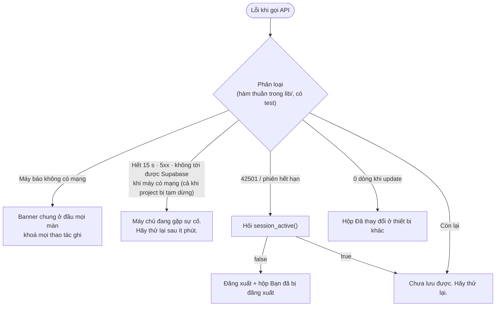

# Xử lý lỗi

Thuộc: [Kiến trúc](index.md).

Spec: [Spec tổng §5](../index.md#5-xử-lý-lỗi-chung) · [S6 §3](../sprint-6/index.md#3-lỗi-api-server-mạng) (thời gian chờ, banner, lỗi theo loại).

## Thời gian chờ, thử lại

| Gọi | Chờ tối đa | Thử lại |
| --- | --- | --- |
| Supabase đọc | 15 s | Tự thử lại 2 lần (chờ 1 s, rồi 3 s) |
| Supabase ghi | 15 s | Không — người dùng bấm lại (`id` app sinh nên không trùng) |
| Gửi ảnh báo lỗi, Edge Function | 60 s | Không |
| Google Calendar | 15 s | `401` → 1 lần với token mới, vẫn lỗi → "Cần kết nối lại Google" · `429` → chờ tăng dần ([google-sync.md](google-sync.md)) |

## Theo tình huống

| Tình huống | Hiện |
| --- | --- |
| Mất mạng | Banner "Không có kết nối mạng." ở đầu mọi màn · khoá Lưu, Xoá, tick, Gửi báo lỗi (nút `+` vẫn mở form) · vẫn xem dữ liệu đã có · có mạng lại → banner ẩn, tự tải lại phần đang xem |
| Tải lỗi, đã có dữ liệu trên máy | Giữ dữ liệu cũ + dòng nhỏ "Chưa cập nhật được · Thử lại" |
| Tải lỗi, chưa có dữ liệu | Thẻ lỗi giữa màn: icon · tiêu đề theo loại · nút "Thử lại" (Lịch, Ghi chú, Chi tiêu) |
| Lưu lỗi | Toast theo loại, giữ form |
| Lưu lỗi sau khi đã hiện ngay (tick, xoá sau Hoàn tác) | Trả dữ liệu về như cũ + toast |
| Từ chối quyền thông báo | Vẫn lưu nhắc · cảnh báo + nút Mở cài đặt máy |
