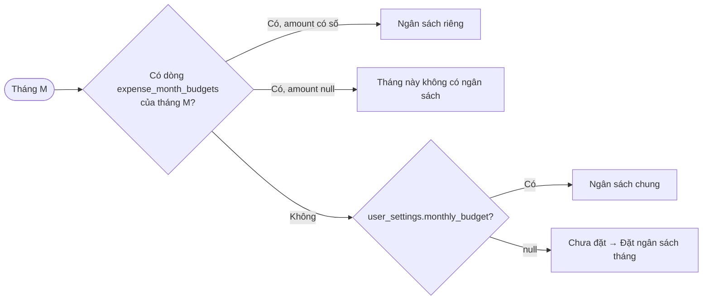
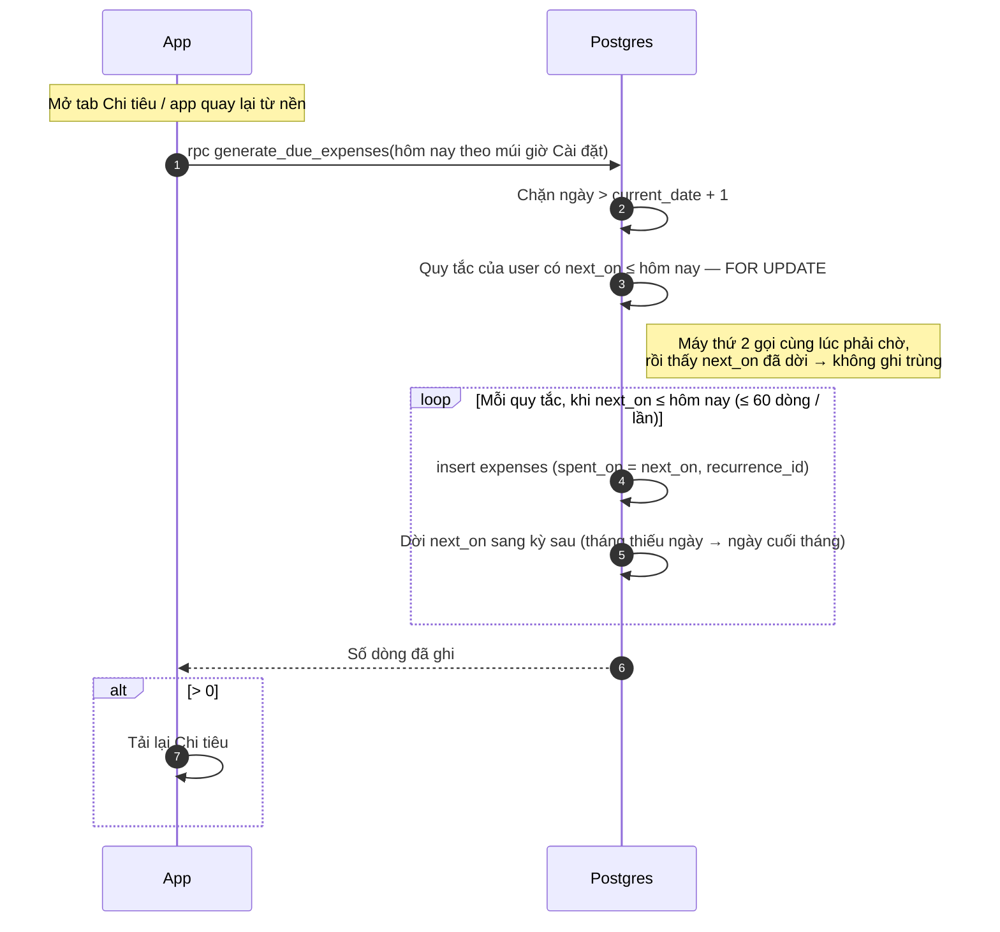

# Chi tiêu

Thuộc: [Kiến trúc](index.md).

Spec: [S4](../sprint-4/index.md) · [S6 §6, §7, §10](../sprint-6/index.md#6-ngân-sách-tháng) (ngân sách, khoản chi lặp, theo nhóm). Bảng: [database.md](database.md).

## Đọc

- Ngày / Tuần / Tháng: tải khoản chi trong kỳ (index `(user_id, spent_on)`) → gộp theo nhóm trên máy → Tổng chi + danh sách nhóm (icon · tên · số tiền · %). Bấm nhóm → pop-up các khoản chi của nhóm trong kỳ.
- Biểu đồ "6 tháng gần đây": DB cộng từng tháng (`expense_monthly_totals`), không tải từng khoản.
- Tháng: thanh ngân sách dưới Tổng chi.

## Ngân sách tháng

- Hàm "ngân sách của tháng" là hàm thuần, có test. Màu thanh: < 80% `primary` · 80–100% `warning` · > 100% `error`. Không báo khi sắp vượt.
- Lưu theo tài khoản → 2 máy thấy như nhau.

## Khoản chi lặp lại

Hằng tuần / hằng tháng. 1 dòng quy tắc (`expense_recurrences`), app tự ghi khoản chi tới hạn.

- Hàm chạy `security invoker` → RLS vẫn áp dụng; máy đã bị đăng xuất không ghi được.
- Tạo quy tắc: chỉ khi tạo khoản chi mới (dòng "Lặp lại") · ngày bắt đầu ≤ hôm nay → ghi ngay khoản đầu tiên. `anchor_day` giữ ngày gốc để tháng ngắn không làm trôi ngày (31 → 30 → vẫn 31 tháng sau).
- Cách tính kỳ kế tiếp có cả ở app (`lib/expenses/`, hàm thuần có test) để hiện "Lần tới" và tạo `next_on` ban đầu; test SQL so khớp với app.
- Khoản chi tự ghi là khoản chi thường (icon lặp nhỏ): sửa, xoá được, xoá rồi không bị ghi lại. Sửa / xoá quy tắc chỉ ảnh hưởng các lần sau (`recurrence_id` → `set null`). Xoá nhóm → xoá cả quy tắc của nhóm.
- Lâu không mở app → ghi bù mọi kỳ đã qua, tối đa 60 khoản / lần gọi.
