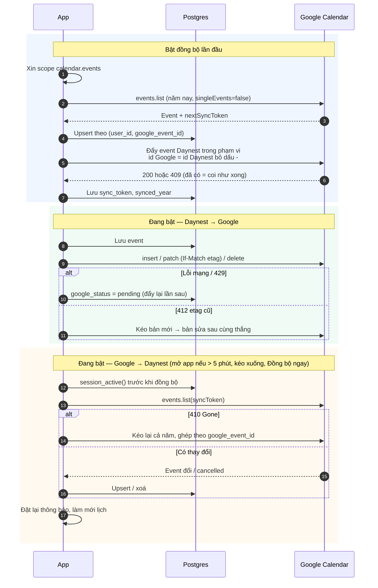

# Đồng bộ Google Calendar

Thuộc: [Kiến trúc](index.md).

**(chưa code)** — spec: [S2 F4](../sprint-2/F4-google-calendar.md). Chỉ khi bật trong Cài đặt; phạm vi = event năm hiện tại + event lặp còn diễn ra trong năm (không đẩy lặp âm).

- Token Google chỉ ở trên máy (SDK tự làm mới), không lưu DB.
- Tắt đồng bộ → giữ nguyên dữ liệu 2 bên, giữ `google_event_id` để bật lại ghép đúng, không trùng.
