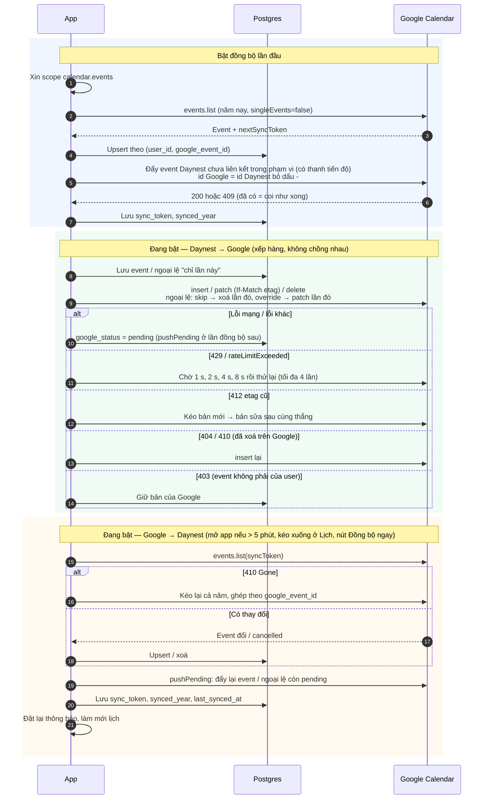

# Đồng bộ Google Calendar

Thuộc: [Kiến trúc](index.md).

Spec: [S2 F4](../sprint-2/F4-google-calendar.md). Code: `features/google/` (`sync.ts` điều phối, `push.ts`, `pull.ts`, `client.ts`), `lib/google/` (đổi định dạng, phạm vi). Chỉ khi bật trong Cài đặt; phạm vi = event năm hiện tại + event lặp còn diễn ra trong năm (không đẩy lặp âm).

- Token Google chỉ ở trên máy (SDK tự làm mới), không lưu DB. `401` → thử lại 1 lần với token mới → vẫn lỗi: "Cần kết nối lại Google".
- Không gọi riêng `session_active()`: máy đã bị đá ra thì RLS từ chối mọi lệnh ghi DB.
- Không đẩy lên Google: event lặp âm lịch, event chỉ xem (`google_readonly` — kiểu lặp của Google mà Daynest không biểu diễn được, lưu từng lần trong năm).
- Xoá event đã liên kết: ẩn trước (`deleted_at`), xoá hẳn khi Google xác nhận.
- Năm mới (`synced_year` khác năm nay) → kéo lại cả năm.
- Tắt đồng bộ → giữ nguyên dữ liệu 2 bên, giữ `google_event_id` để bật lại ghép đúng, không trùng.
