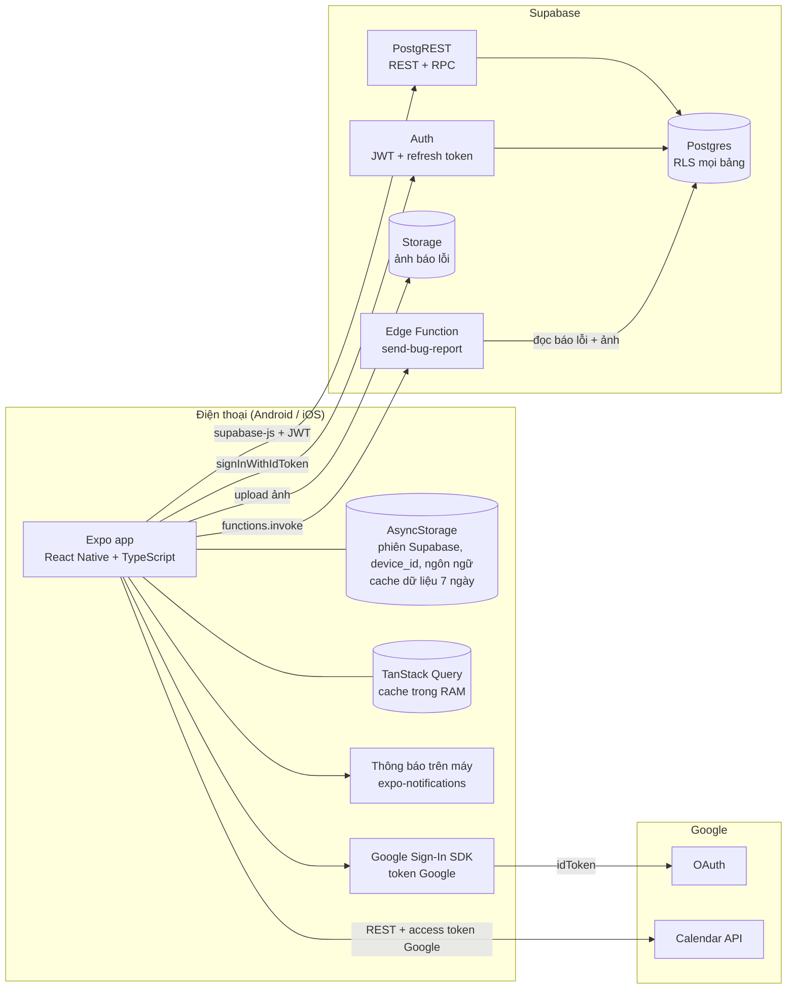
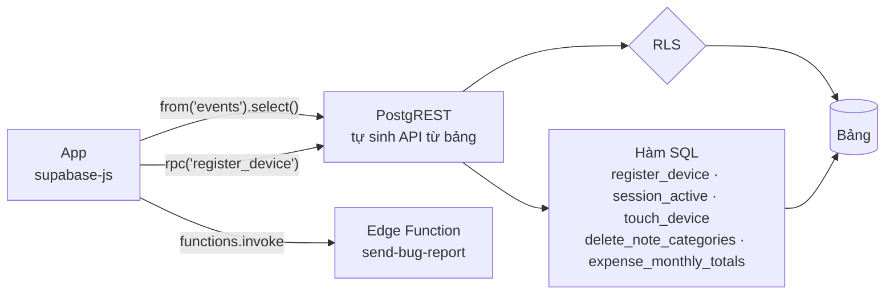
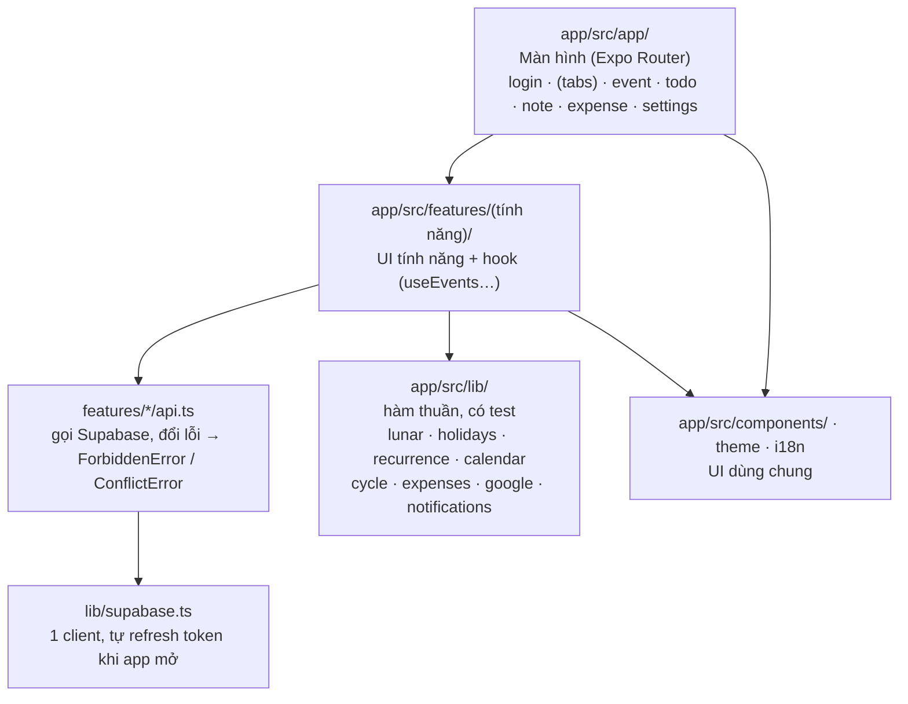

# Kiến trúc Daynest

Thuộc: [Spec tổng](../index.md) §3. Biểu đồ Mermaid; chi tiết nằm ở spec gốc (link ở mỗi file).

Trạng thái: theo code v5.0.1 (hết S5), cập nhật 2026-10-14. Bản tóm tắt 1 trang có sơ đồ: [overview.md](../../overview.md).

## Các file

| File | Nội dung |
| --- | --- |
| [database.md](database.md) | Bảng, quan hệ, nguyên tắc lưu, RLS |
| [user-flow.md](user-flow.md) | User đi qua các màn ra sao |
| [auth.md](auth.md) | Đăng nhập, vòng đời phiên, giới hạn 2 thiết bị |
| [calendar.md](calendar.md) | Đọc lịch: event, todo, kỳ kinh; trải lần lặp |
| [data-writes.md](data-writes.md) | Ghi dữ liệu: không trùng, không mất |
| [conflicts.md](conflicts.md) | Xung đột: 2 tài khoản, 2 máy cùng tài khoản |
| [google-sync.md](google-sync.md) | Đồng bộ Google Calendar 2 chiều |
| [reminders.md](reminders.md) | Nhắc nhở bằng thông báo trên máy |
| [traffic.md](traffic.md) | Xử lý traffic, mục tiêu tải |
| [errors.md](errors.md) | Xử lý lỗi |
| [bug-report.md](bug-report.md) | Báo lỗi: ảnh lên Storage, Edge Function gửi Gmail |
| [supabase-plans.md](supabase-plans.md) | Các gói Supabase, gói nên dùng |

## Tổng quan hệ thống

Không có server riêng. App gọi thẳng Supabase (dữ liệu) và Google (đăng nhập, lịch). Mọi quyền truy cập dữ liệu do Postgres RLS quyết định.

| Thành phần | Vai trò | Không làm |
| --- | --- | --- |
| Expo app | Toàn bộ UI + logic: trải event/todo lặp, âm lịch, dự đoán kỳ kinh, chọn mốc nhắc, đồng bộ Google | Không chạy nền khi app đóng (trừ thông báo đã đặt) |
| Supabase Auth | Đổi `idToken` Google → phiên Supabase (JWT có `session_id`) | Không lưu token Google |
| Postgres + RLS | Lưu dữ liệu, chặn truy cập chéo user, chặn máy đã bị đăng xuất | Không có logic nghiệp vụ ngoài vài hàm (`register_device`…) |
| Storage + Edge Function | Giữ ảnh báo lỗi; gửi email báo lỗi qua Gmail SMTP cho nhà phát triển ([bug-report.md](bug-report.md)) | Không làm việc nghiệp vụ khác |
| Google Calendar | Lịch chính của user, đồng bộ 2 chiều khi bật | Không webhook, không đồng bộ nền |

## API đến từ đâu

Không có backend tự viết (không Go, không Node). Supabase **tự sinh** REST API từ các bảng; logic phía server chỉ là RLS + vài hàm SQL + 1 Edge Function.

| Phần | Ai viết | Ở đâu |
| --- | --- | --- |
| API đọc / ghi bảng | Không ai — PostgREST tự sinh | Supabase |
| Phân quyền | Luật RLS (SQL) | `supabase/migrations/` |
| Logic phía server | Vài hàm SQL, gọi qua `supabase.rpc(...)`; trigger (tạo dữ liệu user mới, `updated_at`, giới hạn 5 báo lỗi/ngày) | `supabase/migrations/` |
| Gửi email báo lỗi | Edge Function (TypeScript / Deno) | `supabase/functions/send-bug-report/` |
| Logic nghiệp vụ còn lại: trải lần lặp, âm lịch, chu kỳ, nhắc, đồng bộ Google | TypeScript | `app/src/lib/`, `app/src/features/` |

- Go API: chỉ làm sau GĐ1 (đọc bill bằng Claude API) — [Spec tổng §2](../index.md#2-quyết-định-chung).
- Supabase Edge Functions: chỉ `send-bug-report` (cần service role để đọc ảnh, giữ mật khẩu Gmail ngoài app). Deploy: `supabase/db functions`.

## Các lớp trong app

- `lib/` không gọi mạng, không import React → test bằng Jest (`app/src/__tests__/`).
- `api.ts` tách khỏi UI → hook (TanStack Query) lo cache, làm mới, gom lỗi.
- `AuthProvider` bọc toàn app: giữ `profile`, `settings`, kiểm tra phiên khi mở app / về foreground.
