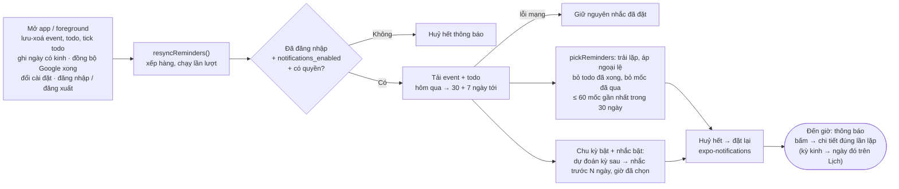

# Nhắc nhở

Thuộc: [Kiến trúc](index.md).

Spec: [S2 F3](../sprint-2/F3-reminders.md) · [S5](../sprint-5/index.md) (todo, nhắc kỳ kinh). Code: `features/reminders/reminderSync.ts`, `lib/notifications/`.

Thông báo đặt sẵn trên từng máy từ dữ liệu DB; không push từ server.

- Tải dữ liệu **trước** khi huỷ: mất mạng thì nhắc cũ vẫn còn.
- Event cả ngày nhắc theo 9:00 ngày bắt đầu.
- Giới hạn 60 vì hệ điều hành giữ số thông báo chờ có hạn (iOS ≤ 64). Mốc nhắc xa nhất là "trước 1 tuần", nên tải thêm 7 ngày sau mốc 30 ngày.
- Từ chối quyền thông báo → vẫn lưu mốc nhắc trong DB, gợi ý bật quyền ([errors.md](errors.md)).
