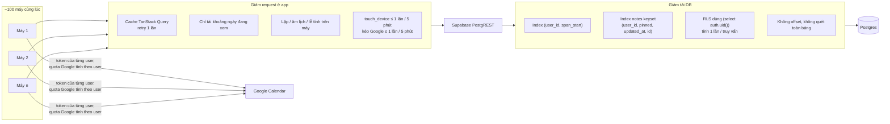

# Xử lý traffic

Thuộc: [Kiến trúc](index.md).

Mục tiêu: 100 user cùng lúc, tổng ~10.000 user ([Spec tổng §3](../index.md#mục-tiêu-tải) · gói Supabase: [supabase-plans.md](supabase-plans.md)).

| Cơ chế | Tác dụng |
| --- | --- |
| Không server riêng, không trạng thái chung giữa user | Không có điểm nghẽn ngoài Supabase; mỗi user chỉ chạm dòng của mình |
| Event lặp lưu 1 dòng | DB ~10–50 KB/user → 100–500 MB cho 10.000 user (sát 500 MB, theo dõi) |
| Truy vấn theo khoảng ngày + index | Đọc lịch tháng chỉ vài chục dòng/user |
| Google `429` / `rateLimitExceeded` | Chờ tăng dần rồi thử lại (lúc đẩy hàng loạt) |
| Kiểm tra tải mỗi sprint | DB local, seed 10.000 user, 100 user ảo × 5 phút → 0 lỗi, p95 < 1 s ([S2 db.md](../sprint-2/design/db.md#kiểm-tra-tải)) |
